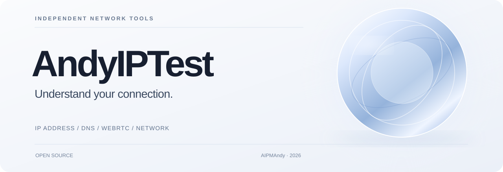

  

<h1 align="center">AndyIPTest</h1>

<strong>一个入口，看清你的网络环境。</strong>

  免费开源，无需注册。查询公网 IP、排查 DNS / WebRTC 泄漏，找到适合的网络诊断工具。

  <a href="https://aipmandy.github.io/AndyIPTest/"><strong>在线使用</strong></a>
  &nbsp; · &nbsp;
  <a href="#本地运行">本地运行</a>
  &nbsp; · &nbsp;
  <a href="#参与贡献">参与贡献</a>
  &nbsp; · &nbsp;
  <a href="https://metaver.vip/">作者官网</a>

HTML / CSS / JavaScript &nbsp; · &nbsp; GitHub Pages &nbsp; · &nbsp; MIT License

---

## 这是什么

AndyIPTest 是一个轻量的 **IP 检测与网络工具工作台**。需要确认当前网络出口、排查代理分流、核对 DNS / WebRTC，或者寻找专业工具时，无需记住十几个网站。

**26 个工具入口、6 类诊断场景。** 基础信息由本站按需查询，深度测试通过链接前往独立的专业服务。

| 你要做的事 | 具体功能 |
| --- | --- |
| **确认网络出口** | 查询当前公网 IP、IP 归属地、ISP / ASN，失败时回退到仅 IP 查询 |
| **检查 IPv4 / IPv6** | 分别测试两种协议的出口，区分请求失败与协议不支持 |
| **查询指定 IP** | 输入有效 IPv4 / IPv6，查询第三方数据库中的归属信息 |
| **排查网络泄漏** | 快速前往 DNS、WebRTC 与浏览器指纹检测站 |
| **定位网络问题** | 网速测试、DNS 传播、BGP、跨地区节点诊断等专业入口 |
| **管理常用工具** | 分类、搜索、收藏、浅色与深色主题 |

## 推荐的排查顺序

**01 · 确认出口** — 先核对公网 IP、运营商和代理分流结果。

**02 · 检查泄漏** — 分别验证 DNS、WebRTC 和 IPv4 / IPv6 是否符合预期。

**03 · 交叉核对** — 参考多个数据源。第三方风险标签不等于任何平台的审核结果。

> **检测边界：** 本站不会自行完成深度 DNS / WebRTC 探测，也不会给出虚构的「IP 纯净度 100 分」。相关检测由外部专业工具完成。

## 本地运行

无构建步骤、无 npm 依赖，无需数据库。

~~~bash
git clone https://github.com/AIPMAndy/AndyIPTest.git
cd AndyIPTest
python3 -m http.server 8000
~~~

在浏览器打开 **http://localhost:8000/**。页面也能直接部署到 GitHub Pages 等静态托管平台。

## 项目结构

~~~text
AndyIPTest/
├── index.html                 # 网站页面
├── assets/
│   ├── app.js                 # IP 查询、工具目录与交互
│   ├── style.css              # 基础样式
│   ├── editorial.css          # 视觉与响应式布局
│   └── readme-cover.svg       # 仓库品牌横幅
├── tests/                     # 回归与浏览器测试
├── .github/                   # CI、Pages 部署及 Issue 模板
├── CONTRIBUTING.md            # 贡献指南
├── AUDIT.md                   # 初版审核历史
└── LICENSE                    # MIT
~~~

### 验证

~~~bash
node --check assets/app.js
node tests/verify.mjs
~~~

可选浏览器测试见 <code>tests/browser_smoke.py</code>，使用模拟数据，不代表真实网络中的 CORS、可达性或第三方 API 可用性。查看最新状态：[GitHub Actions](https://github.com/AIPMAndy/AndyIPTest/actions)。

## 隐私与使用边界

- **按需请求**：加载页面时不会主动向 IP 查询 API 发起检测；点击按钮后，才请求 <code>ipwho.is</code> 或 <code>ipify</code>。
- **本地数据**：浏览器语言、时区、屏幕与平台信息仅在本地展示；收藏与主题存在本机浏览器的 <code>localStorage</code>。
- **第三方服务**：查询服务和外部工具可能收集请求 IP、时间等数据；GitHub Pages 托管方也可能记录常规访问日志。
- **服务限制**：免费 IP 信息服务存在配额与限流，数据库定位可能存在误差。请求失败不能直接推断网络协议不可用。

详见 [初版审计记录](AUDIT.md) 和 [IP 查询接口文档](https://ipwhois.io/documentation)。接口政策可能变化，实际以服务商条款为准。

## 参与贡献

发现失效链接、错误分类或更好的检测工具？欢迎 [提交 Issue](https://github.com/AIPMAndy/AndyIPTest/issues/new/choose) 或 Pull Request。

新增工具应提供官方 HTTPS 地址、明确的功能说明和可核实的依据。不收录广告跳转、夸大风险评分或未经授权复制的素材。详见 [CONTRIBUTING.md](CONTRIBUTING.md)。

---

  <strong>AndyIPTest</strong> 
  Built by <a href="https://github.com/AIPMAndy">AIPMAndy</a> · <a href="https://metaver.vip/">AI 酋长 Andy</a> · <a href="LICENSE">MIT License</a>

